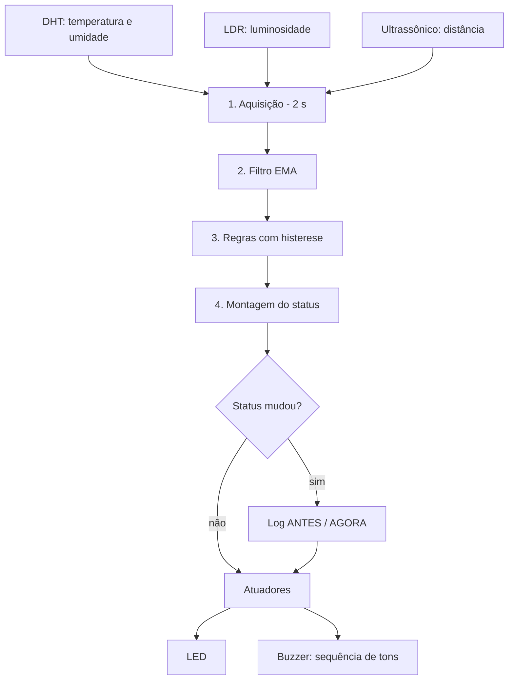

# EcoShield IoT


Sistema embarcado de monitoramento local de **estufa** e **reservatório de água**, desenvolvido para o **Checkpoint 5 de Edge Computing**.

O ESP32 adquire dados de três sensores, filtra, avalia regras com histerese e aciona alertas visuais e sonoros. Todo o processamento ocorre no próprio dispositivo, sem dependência de rede ou nuvem.
---
## Demonstração

| Recurso | Link |
|---|---|
| Vídeo de apresentação | [Assistir no Canva](https://www.canva.com/design/DAHYB9LWoFk/VKXwPA_sCY7bpOvDjjiCvg/edit) |
| Simulação no Wokwi | [Abrir projeto](https://wokwi.com/projects/477263048336414721) |

---

## Sumário

1. [Contexto e objetivo](#1-contexto-e-objetivo)
2. [Funcionalidades](#2-funcionalidades)
3. [Hardware](#3-hardware)
4. [Instalação e execução](#4-instalação-e-execução)
5. [Arquitetura](#5-arquitetura)
6. [Especificação técnica](#6-especificação-técnica)
7. [Parâmetros de configuração](#7-parâmetros-de-configuração)
8. [Saída serial](#8-saída-serial)
9. [Plano de testes](#9-plano-de-testes)
10. [Considerações técnicas](#10-considerações-técnicas)
11. [Solução de problemas](#11-solução-de-problemas)
12. [Limitações conhecidas](#12-limitações-conhecidas)
13. [Roadmap](#13-roadmap)
14. [Conformidade com o checkpoint](#14-conformidade-com-o-checkpoint)
15. [Estrutura do repositório](#15-estrutura-do-repositório)
16. [Autores](#16-autores)

---

## 1. Contexto e objetivo

Uma estufa está exposta a quatro riscos operacionais principais:

| Risco | Consequência |
|---|---|
| Temperatura elevada | Estresse térmico e perda de plantas |
| Umidade do ar baixa | Ressecamento |
| Luminosidade excessiva | Queima das folhas |
| Reservatório vazio | Interrupção da irrigação |

**Objetivo:** detectar essas condições localmente, informar **qual** problema ocorreu e permitir que o operador reaja sem consultar um painel.

**Justificativa de edge computing:** a decisão é tomada no dispositivo. O sistema opera sem internet, com baixa latência e sem custo de infraestrutura.

---

## 2. Funcionalidades

- Aquisição de temperatura, umidade, luminosidade e distância da água.
- Filtro de média móvel exponencial para reduzir ruído.
- Regras com **histerese** para evitar oscilação dos alertas.
- Conversão da distância em **nível percentual** do reservatório.
- Alerta sonoro com **um tom distinto por problema**, executado em sequência.
- Indicação visual por LED (alerta e falha de sensor).
- Log de **mudança de estado** (`ANTES → AGORA`) no monitor serial.
- Tratamento de leituras inválidas.
- Execução não bloqueante, baseada em `millis()`.

---

## 3. Hardware

### 3.1 Componentes e pinagem

| Componente | Função | Pino ESP32 |
|---|---|---|
| DHT11 (hardware real) / DHT22 (Wokwi) | Temperatura e umidade | GPIO 15 |
| Módulo LDR | Luminosidade | GPIO 34 (saída AO) |
| Sensor ultrassônico | Distância até a água | TRIG: GPIO 25 / ECHO: GPIO 18 |
| LED | Alerta visual | GPIO 21 |
| Buzzer passivo | Alerta sonoro | GPIO 4 |

### 3.2 Notas de ligação

- **DHT:** alimentação em 3,3 V; sinal no GPIO 15.
- **LDR:** módulo padrão de quatro pinos (VCC, GND, AO, DO). Utilizar apenas o **AO**. A saída DO não é usada.
- **Sensor ultrassônico:** alimentação em 5 V. O pino ECHO opera em 5 V; utilizar **divisor de tensão** (por exemplo, 1 kΩ e 2 kΩ) antes do ESP32. No Wokwi não é necessário.
- **Buzzer:** deve ser **passivo**, pois a frequência é gerada por `tone()`.
- **LED:** resistor em série de 220 Ω.
- **Posicionamento:** o sensor ultrassônico fica no topo do reservatório, apontado para a superfície da água.

---

## 4. Instalação e execução

### 4.1 Requisitos

| Item | Especificação |
|---|---|
| Placa | ESP32 Dev Module |
| Core | Arduino-ESP32 2.x ou 3.x |
| Biblioteca | DHT sensor library (Adafruit) |
| Biblioteca | Adafruit Unified Sensor (Adafruit) |
| Monitor serial | 115200 baud |

### 4.2 Versões do código

| Arquivo | Sensor | Uso |
|---|---|---|
| `EcoShield_IoT_Wokwi_DHT22.ino` | DHT22 | Simulação no Wokwi |
| `EcoShield_IoT_DHT11.ino` | DHT11 | Placa e sensor reais |

O Wokwi não oferece o DHT11. As duas versões diferem apenas em `DHTTYPE` e `DHT_NOME`.

### 4.3 Hardware real

1. Montar o circuito conforme a seção 3.
2. Instalar as bibliotecas (Arduino IDE: *Ferramentas → Gerenciar Bibliotecas*).
3. Abrir `EcoShield_IoT_DHT11.ino`.
4. Selecionar a placa e a porta serial.
5. Gravar o firmware.
6. Abrir o monitor serial em 115200 baud.

### 4.4 Wokwi

1. Criar um projeto ESP32 e montar o circuito com **DHT22**.
2. Colar o conteúdo de `EcoShield_IoT_Wokwi_DHT22.ino`.
3. Adicionar ao `libraries.txt`:
   ```
   DHT sensor library
   Adafruit Unified Sensor
   ```
4. Iniciar a simulação.

---

## 5. Arquitetura



### 5.1 Funções

| Função | Responsabilidade |
|---|---|
| `setup()` | Configura pinos, serial, DHT e ADC |
| `loop()` | Orquestra o ciclo e executa o buzzer a cada iteração |
| `lerSensores()` | Adquire DHT, LDR e ultrassônico |
| `aplicarFiltro()` | Aplica a média móvel exponencial |
| `avaliarRegras()` | Atualiza os alertas com histerese |
| `montarStatus()` | Gera o texto de status |
| `exibirRelatorio()` | Imprime os dados no monitor serial |
| `registrarMudanca()` | Registra transições de estado |
| `atualizarLed()` | Controla o LED |
| `atualizarBuzzer()` | Executa a sequência de tons |
| `filtrar()` | Cálculo da média móvel exponencial |
| `acima()` / `abaixo()` | Regras de histerese |
| `lerDistancia()` | Medição ultrassônica; retorna -1 em falha |
| `calcularNivel()` | Converte distância em nível percentual |

### 5.2 Modelo de execução

O firmware usa um laço cooperativo (*super-loop*) com **duas bases de tempo**:

| Base de tempo | Periodicidade | Responsável |
|---|---|---|
| Ciclo de sensores | 2 s | `loop()` com `millis()` |
| Buzzer | A cada iteração do `loop()` | `atualizarBuzzer()` |

Não há `delay()` no programa. Os únicos bloqueios são `delayMicroseconds()` no pulso do TRIG e `pulseIn()` (até 30 ms por ciclo).

### 5.3 Organização do código

- Constantes agrupadas no topo (pinos, limites, tempos).
- `struct Limite` representa o par liga/desliga de cada regra.
- `enum Problema` define a ordem do status e da sequência do buzzer.
- Sem uso de `String`: o status usa buffer fixo, evitando fragmentação de memória.

---

## 6. Especificação técnica

### 6.1 Aquisição

| Sensor | Método | Tratamento |
|---|---|---|
| DHT | `readTemperature()` e `readHumidity()` | `NaN` em qualquer valor torna a leitura inválida |
| LDR | `map(analogRead(PIN_LDR), 0, 4095, 100, 0)` | Inverte a faixa: 0 = escuro, 100 = muita luz |
| Ultrassônico | Pulso de 10 µs no TRIG e `pulseIn()` com timeout de 30 ms | Ver regras abaixo |

O módulo LDR entrega valor **maior no escuro**; por isso a faixa de saída do `map()` é invertida.

**Regras do ultrassônico:**
- Distância = `tempo × 0,0343 / 2` (cm).
- Sem eco: leitura inválida.
- Menor que 2 cm: leitura inválida.
- Maior que 400 cm: limitada a 400 cm (continua válida).

### 6.2 Filtro

```
filtrado = anterior + ALPHA × (novo − anterior)
```

- `ALPHA = 0,5`. Valores maiores respondem mais rápido; menores filtram mais.
- A primeira leitura válida inicializa o filtro.
- Leituras inválidas não alimentam o filtro.

### 6.3 Nível de água

```
nível (%) = (80 − distância) / (80 − 5) × 100        limitado entre 0 e 100
```

| Distância | Nível |
|---|---|
| 5 cm ou menos | 100 % (cheio) |
| 80 cm ou mais | 0 % (vazio) |

O sensor mede até 400 cm, mas a faixa útil do reservatório é de 5 a 80 cm. Acima de 80 cm, o nível permanece em 0 %.

### 6.4 Regras com histerese

Cada regra possui dois limiares. Entre eles, o alerta **mantém o estado anterior**, evitando acionamentos repetidos perto do limite.

| Variável | Condição | Alerta liga | Alerta desliga |
|---|---|---|---|
| Temperatura | Acima | > 31 °C | < 30 °C |
| Umidade | Abaixo | < 35 % | > 38 % |
| Luminosidade | Acima | > 60 % | < 55 % |
| Nível de água | Abaixo | < 20 % | > 25 % |

Para o nível de água, o alerta liga com distância acima de cerca de **65 cm** e desliga abaixo de cerca de **61 cm**.

Os alertas de temperatura e umidade só são reavaliados com leitura válida do DHT. O alerta de água só é reavaliado com leitura válida do ultrassônico.

### 6.5 Status e log de mudança

O status é um texto montado a cada ciclo, na ordem água, temperatura, umidade e luz:

```
[AGUA BAIXA] [TEMP ALTA] [UMIDADE BAIXA] [LUZ EXCESSIVA]
[OK]
[SENSOR INVALIDO]
```

Quando o texto muda, o sistema registra a transição:

```
>>> MUDANCA DE ESTADO <<<
    ANTES: [OK]
    AGORA: [TEMP ALTA]
```

O log é o mecanismo que evidencia a reação do sistema às mudanças dos sensores.

### 6.6 Atuadores

**LED**

| Situação | Estado |
|---|---|
| Sem alertas | Apagado |
| Algum alerta | Aceso fixo |
| Sensor inválido, sem alertas | Piscando |

**Buzzer**

| Problema | Frequência |
|---|---|
| Água baixa | 500 Hz |
| Temperatura alta | 1000 Hz |
| Umidade baixa | 1500 Hz |
| Luz excessiva | 2000 Hz |

Sequência de execução:

1. Toca o tom do problema por **0,8 s**.
2. Pausa de **0,5 s**.
3. Avança para o **próximo problema ativo**.
4. Ordem: água, temperatura, umidade, luz. Após o último, reinicia.

Exemplos:

| Situação | Comportamento |
|---|---|
| Apenas temperatura | 1000 Hz por 0,8 s, pausa, repete |
| Os quatro problemas | 500, 1000, 1500 e 2000 Hz; ciclo completo de 5,2 s |
| Nenhum problema | Silêncio |

`atualizarBuzzer()` é uma pequena máquina de estados baseada em `millis()`.

### 6.7 Tratamento de falhas

- DHT ou ultrassônico inválido: o status inclui `[SENSOR INVALIDO]`.
- Com falha de sensor e sem alertas, o LED pisca e o buzzer permanece mudo.
- O status `[OK]` não é exibido quando há sensor inválido.
- Leituras inválidas não contaminam o filtro.

---

## 7. Parâmetros de configuração

Todos os parâmetros são constantes no topo do código.

| Constante | Valor | Descrição |
|---|---|---|
| `LIM_TEMP` | 31 / 30 °C | Liga / desliga do alerta de temperatura |
| `LIM_UMID` | 35 / 38 % | Liga / desliga do alerta de umidade |
| `LIM_LUZ` | 60 / 55 % | Liga / desliga do alerta de luz |
| `LIM_AGUA` | 20 / 25 % | Liga / desliga do alerta de nível |
| `DIST_CHEIO` | 5 cm | Distância correspondente a 100 % |
| `DIST_VAZIO` | 80 cm | Distância correspondente a 0 % |
| `DIST_MIN_SENSOR` | 2 cm | Menor distância válida |
| `DIST_MAX_SENSOR` | 400 cm | Alcance máximo do sensor |
| `VELOCIDADE_SOM_CM_US` | 0,0343 | Velocidade do som (cerca de 20 °C) |
| `TIMEOUT_ECHO_US` | 30000 µs | Tempo máximo de espera pelo eco |
| `ADC_MAX` | 4095 | Resolução do ADC (12 bits) |
| `ALPHA` | 0,5 | Coeficiente do filtro |
| `INTERVALO_MS` | 2000 ms | Período do ciclo de sensores |
| `T_TOM_MS` | 800 ms | Duração de cada tom |
| `T_PAUSA_MS` | 500 ms | Pausa entre tons |

---

## 8. Saída serial

Funcionamento normal:

```
==============================
Temperatura: 24.0 C
Umidade:     60.0 %
Luminosidade: 45 %
Nivel de agua: 53 % (distancia 40.0 cm)
STATUS: [OK]
```

Mudança de estado:

```
==============================
Temperatura: 32.5 C
Umidade:     60.0 %
Luminosidade: 45 %
Nivel de agua: 53 % (distancia 40.0 cm)
STATUS: [TEMP ALTA]
>>> MUDANCA DE ESTADO <<<
    ANTES: [OK]
    AGORA: [TEMP ALTA]
```

> Os exemplos são ilustrativos. Substituir por capturas da simulação ou do hardware.

---

## 9. Plano de testes

Alterar **um sensor por vez**. Com `ALPHA = 0,5`, aguardar de 2 a 4 ciclos (4 a 8 s) para o filtro acompanhar.

| Teste | Ação | Resultado esperado |
|---|---|---|
| Temperatura alta | Elevar acima de 31 °C | `TEMP ALTA`, LED aceso, 1000 Hz |
| Retorno ao normal | Reduzir abaixo de 30 °C | Status volta a `OK` |
| Umidade baixa | Reduzir abaixo de 35 % | `UMIDADE BAIXA`, 1500 Hz |
| Luz excessiva | Aumentar a luminosidade | `LUZ EXCESSIVA`, 2000 Hz |
| Água baixa | Distância acima de 70 cm | `AGUA BAIXA`, 500 Hz |
| Sensor inválido | Desconectar o DHT | LED piscando, buzzer mudo |
| Histerese | Temperatura entre 30 e 31 °C | Estado não oscila |
| Todos os problemas | Forçar os quatro alertas | Sequência 500, 1000, 1500, 2000 Hz |

> **Wokwi:** o ultrassônico inicia em **400 cm**, equivalente a 0 % de nível, o que dispara `AGUA BAIXA` na partida. Ajustar a distância para cerca de **40 cm** para obter o estado normal.

---

## 10. Considerações técnicas

- **DHT11 e DHT22:** o DHT11 tem precisão de ±2 °C e ±5 % de umidade, com leitura inteira. O DHT22 é bem mais preciso.
- **GPIO 15:** é pino de *strapping* (boot). Carga ou pull-up inadequado pode afetar a inicialização. Alternativa: GPIO 27.
- **GPIO 34:** somente entrada, com ADC; adequado ao LDR.
- **Pinos a evitar:** GPIO 0, 2, 12 e 15 (boot) e GPIO 6 a 11 (flash).
- **ADC:** configurado em 12 bits.
- **`tone()` e `noTone()`:** disponíveis nos cores 2.x e 3.x. Validar na versão utilizada.
- **Intervalo de 2 s:** atende ao mínimo de amostragem do DHT (1 s no DHT11, 2 s no DHT22).
- **Precisão do buzzer:** como o buzzer é atendido a cada iteração do `loop()`, as transições podem atrasar durante a leitura dos sensores (da ordem de dezenas de ms).
- **Nível lógico do ECHO:** o ESP32 tolera apenas 3,3 V nos pinos de entrada.

---

## 11. Solução de problemas

| Sintoma | Causa provável | Ação |
|---|---|---|
| Caracteres ilegíveis no monitor serial | Baud rate diferente de 115200 | Selecionar 115200 e reiniciar a placa |
| Placa reinicia em loop | Alimentação ou pino de boot | Isolar periféricos; revisar o GPIO 15 |
| `ERRO: leitura do ultrassonico invalida` | TRIG ou ECHO mal ligados | Conferir GPIO 25 (TRIG) e GPIO 18 (ECHO) e a alimentação |
| `AGUA BAIXA` ao iniciar no Wokwi | Distância inicial de 400 cm | Ajustar para cerca de 40 cm |
| Buzzer mudo | Buzzer ativo, ligação invertida ou nenhum alerta ativo | Usar buzzer passivo; conferir polaridade; forçar um alerta |
| Luminosidade com comportamento oposto | Módulo com lógica diferente | Inverter a faixa do `map()` |
| `ERRO: leitura do DHT invalida` | Sensor ou tipo incorretos | Conferir ligação e o `DHTTYPE` da versão em uso |

---

## 12. Limitações conhecidas

- **Alerta com dado antigo:** se o DHT falhar, os alertas de temperatura e umidade mantêm o último estado.
- **Falha de sensor sem alerta sonoro:** apenas o LED pisca.
- **Limiares não calibrados:** 31 °C, 35 %, 60 % e 20 % não derivam de uma cultura específica.
- **Velocidade do som fixa:** o cálculo de distância não compensa a temperatura real.
- **Ambiente adverso:** umidade alta, condensação e ondulação da água podem distorcer o ultrassônico.
- **LDR relativo:** o valor é percentual, não uma medida em lux.
- **Sem análise de tendência:** o sistema compara com limites, mas não detecta variação rápida.
- **Sem conectividade:** os dados só são exibidos no monitor serial, sem histórico.
- **Sem silenciamento:** o buzzer soa enquanto o alerta existir.

---

## 13. Roadmap

**Curto prazo**
- Compensar a velocidade do som pela temperatura medida.
- Expirar alertas quando o sensor permanece em falha por muito tempo.
- Alerta sonoro para falha de sensor.
- Botão físico para silenciar o buzzer.

**Médio prazo**
- Detecção de tendência (taxa de variação) para alertas preditivos.
- Filtro por mediana para rejeição de picos.
- Alerta por tempo acumulado fora da faixa.
- Limiares por tipo de cultura, em arquivo de configuração.
- Calibração do LDR em lux.

**Longo prazo**
- Atuação: relé para bomba d'água, ventilador e sombreamento, com controle automático.
- Conectividade: Wi-Fi com MQTT, painel (Node-RED ou Grafana) e notificações.
- Dados: histórico em SD ou flash, com relógio RTC.
- Robustez: *watchdog*, tarefas FreeRTOS separadas e atualização OTA.
- Energia: *deep sleep* para operação com bateria ou painel solar.

---

## 14. Conformidade com o checkpoint

| Requisito | Atendimento |
|---|---|
| DHT: temperatura e umidade | Leitura, filtro e alertas de temperatura alta e umidade baixa |
| LDR: luminosidade | `map()` de 0 a 100 e alerta de luz excessiva |
| Ultrassônico: distância | Distância convertida em nível percentual do reservatório |
| Processamento no ESP32 | Filtro, histerese e decisão local, sem nuvem |
| Respostas definidas | LED e buzzer com tom distinto por problema |
| Demonstração de mudanças | Log `ANTES → AGORA` a cada transição de estado |
| Função clara por sensor | Clima, iluminação e reservatório |
| Necessidade real | Proteção da estufa e controle do reservatório |
| Código organizado e comentado | Constantes no topo e etapas em funções |
| Bibliotecas informadas | Cabeçalho do código e seção 4 |
| Ajuste ao sensor utilizado | Versões DHT11 (real) e DHT22 (Wokwi) |

---

## 15. Estrutura do repositório

```
EcoShield-IoT/
├── EcoShield_IoT_Wokwi_DHT22.ino   # versão para simulação
├── EcoShield_IoT_DHT11.ino         # versão para hardware real
├── Arquitetura.txt                 # documentação técnica e códigos
└── README.md                       # este arquivo
```

---

## 16. Autores
Principal Contribuidor:
      -**Kaick Lima Silva, RM:574060.**

- **Pedro Feltrin, RM:569038.**
- **Gustavo Basso, RM:572623.**
- **Guilherme Sales, RM:572933.**
- **Guilherme Kozikoski, RM:571611.**
  

Disciplina: Edge Computing
